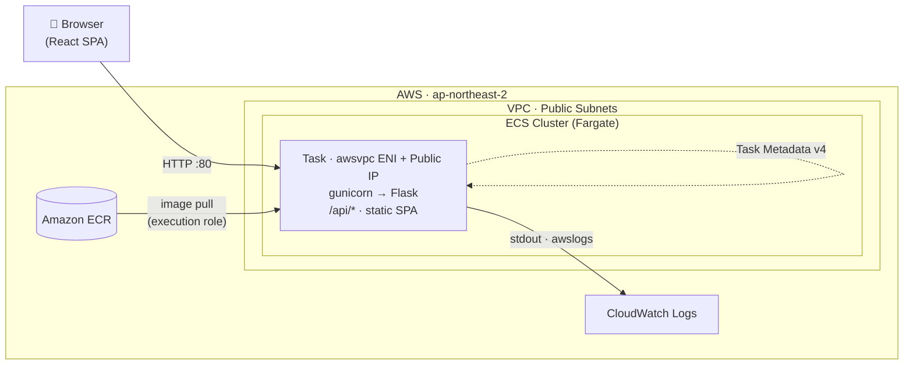
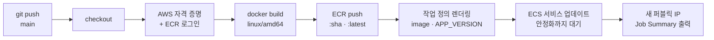
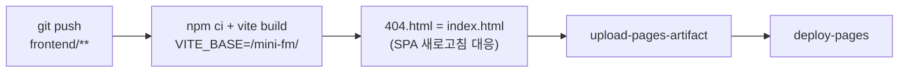
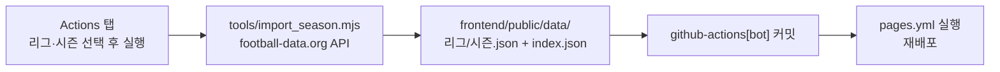
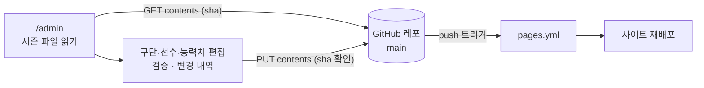

<div align="center">

# ⚽ Mini FM

**컨테이너 기반 웹 서비스 배포 파이프라인 — React · Flask · Docker · AWS ECS Fargate · GitHub Actions · GitHub Pages**

🌐 **[meongkune.github.io/mini-fm](https://meongkune.github.io/mini-fm/)**

모바일 축구 감독 시뮬레이션(FM 스타일)을 소재로,
웹 애플리케이션을 **컨테이너로 패키징하고 AWS 관리형 컨테이너 환경에 배포·운영·자동화**하는 전 과정을 구성한 프로젝트


</div>

---

## 개요

이 프로젝트의 초점은 **"코드를 실제로 서비스되는 상태까지 가져가는 과정"** 입니다.
프론트엔드 빌드, API 서버, 정적 파일 서빙이 모두 있는 현실적인 웹 앱을 하나 만들고, 이를 다음 단계로 배포·운영합니다.

| 단계 | 다루는 내용 | 사용 기술 |
|---|---|---|
| 1. 컨테이너화 | 빌드 환경과 실행 환경을 분리한 멀티 스테이지 이미지, 레이어 캐시, 아키텍처 지정 | Docker, BuildKit |
| 2. 이미지 레지스트리 | 프라이빗 저장소, 인증 토큰 로그인, 태그 전략(커밋 SHA·latest), push 시 취약점 스캔 | Amazon ECR |
| 3. 컨테이너 오케스트레이션 | 클러스터 · 작업 정의 · 서비스, 서버리스 컨테이너 실행, 원하는 Task 수 유지 | Amazon ECS on Fargate |
| 4. 네트워킹 | `awsvpc` 모드(Task별 ENI), 퍼블릭 서브넷 + 퍼블릭 IP, 보안 그룹 인바운드 | VPC, Security Group |
| 5. 관측 | 컨테이너 stdout 로그 수집, 런타임 메타데이터 조회 | CloudWatch Logs, ECS Task Metadata v4 |
| 6. CI/CD | push → 빌드 → 레지스트리 → 새 작업 정의 revision → 롤링 배포 → 안정화 대기 | GitHub Actions |
| 7. 배포 안정성 | 롤링 업데이트(min 100% / max 200%), 실패 시 자동 롤백 | ECS Deployment Circuit Breaker |
| 8. 정적 호스팅 전환 | 서버 로직을 브라우저로 옮겨 서버 없이 운영, SPA 라우팅 폴백 | GitHub Pages, `actions/deploy-pages` |
| 9. 데이터 파이프라인 | 외부 API → 시즌 데이터 생성 → 커밋 → 자동 재배포 | football-data.org, `workflow_dispatch` |
| 10. 서버 없는 관리자 화면 | 브라우저에서 데이터 편집 → GitHub API 커밋 → push 트리거로 재배포 | GitHub REST API (Contents), Fine-grained PAT |

앱 안의 **📡 상태** 탭은 컨테이너가 ECS 작업 메타데이터 엔드포인트를 직접 조회해서, 지금 응답한 Task ID · 가용 영역 · 작업 정의 revision · 이미지 태그 · 리소스를 보여 줍니다. 배포가 실제로 어디서 어떻게 이루어졌는지 화면에서 바로 확인할 수 있습니다.

## 배포 아키텍처



| 항목 | 구성 |
|---|---|
| 실행 환경 | ECS on Fargate · Linux/X86_64 · 0.25 vCPU / 512 MiB |
| 네트워크 | `awsvpc`, 퍼블릭 서브넷, `assignPublicIp=ENABLED`, 보안 그룹 TCP 80 인바운드 |
| 권한 | `ecsTaskExecutionRole` — ECR 이미지 pull, CloudWatch Logs 쓰기 |
| 로그 | `awslogs` 드라이버 → `/ecs/<service>` |
| 배포 | 롤링 업데이트 + 서킷 브레이커(자동 롤백) |

**단일 컨테이너 구성.** Flask가 `/api/*`를 처리하고 React 빌드 결과를 정적 파일로 함께 서빙합니다(클라이언트 라우팅용 SPA 폴백 포함). 별도의 웹 서버나 CORS 설정 없이 컨테이너 하나로 배포 단위가 끝납니다.

**Stateless 서버.** 경기 진행 상태는 클라이언트가 보관해서 요청마다 전달하고, 시즌 기록은 브라우저 `localStorage`에 저장합니다. 서버에 세션이 없어서 Task가 교체(재배포)되거나 수평 확장돼도 진행 중인 경기가 끊기지 않습니다.

## CI/CD 파이프라인



[`.github/workflows/deploy.yml`](.github/workflows/deploy.yml)

- **이미지 태그 = 커밋 SHA 7자리.** 어떤 커밋이 배포됐는지 이미지와 1:1로 추적하고, 앱의 상태 탭에도 같은 버전이 표시됩니다.
- **작업 정의를 코드로 관리.** [`ecs/task-definition.json`](ecs/task-definition.json)을 기준으로 이미지와 버전만 바꿔 새 revision을 등록합니다.
- **`wait-for-service-stability`.** 새 Task가 정상 상태가 될 때까지 기다리므로, 배포 실패가 워크플로 실패로 바로 드러납니다.
- **문서 변경은 배포 제외**(`paths-ignore: **.md`), **동시 배포 방지**(`concurrency`).

| 설정 | 이름 | 설명 |
|---|---|---|
| Secret | `AWS_ACCESS_KEY_ID`, `AWS_SECRET_ACCESS_KEY` | 배포용 IAM 자격 증명 |
| Variable | `AWS_REGION` | 예: `ap-northeast-2` |
| Variable | `ECR_REPOSITORY`, `ECS_CLUSTER`, `ECS_SERVICE` | 배포 대상 리소스 이름 |

## GitHub Pages (현재 운영)

같은 앱을 **서버 없이** 운영하는 구성입니다. 경기 엔진을 JavaScript로 옮겨 브라우저에서 계산하고, 리그·시즌 데이터는 정적 JSON으로 배포합니다. 서버 비용이 없고 컨테이너가 꺼질 일도 없습니다.



[`.github/workflows/pages.yml`](.github/workflows/pages.yml)

- **경로 기준(base).** 레포 이름 하위 경로(`/mini-fm/`)에서 동작하도록 Vite `base`와 React Router `basename`을 같은 값으로 맞춥니다.
- **SPA 폴백.** Pages는 서버 라우팅이 없어 `/league` 같은 경로를 새로고침하면 404가 납니다. `404.html`을 `index.html`과 같게 두어 앱이 경로를 처리합니다.
- **같은 화면, 두 환경.** 📡 상태 탭은 `/api/meta`가 있으면 ECS 정보를, 없으면 빌드 버전·빌드 시각·데이터 출처를 보여 줍니다.

## 시즌 데이터 파이프라인



[`.github/workflows/import-season.yml`](.github/workflows/import-season.yml) · [`tools/import_season.mjs`](tools/import_season.mjs)

- **토큰은 Secret으로만.** API 토큰(`FOOTBALL_DATA_TOKEN`)은 Actions 실행 중에만 환경 변수로 주입되고 코드·데이터에는 남지 않습니다.
- **API에 없는 값은 규칙으로 생성.** 구단·선수·포지션·나이는 API 값을 쓰고, 능력치는 전 시즌 순위(구단 기준치) + 나이 곡선 + 선수 ID 기반 고정 난수로 만듭니다. 같은 입력이면 항상 같은 결과가 나옵니다.
- **1군 25명.** 포지션별 최소 인원(GK 3 · DF 8 · MF 8 · FW 5)을 먼저 채우고 나머지를 능력치 순으로 뽑습니다. 등번호가 없으면 포지션별 관례 번호(GK 1, ST 9 …)를 배정합니다.
- **안정적인 ID.** 선수 ID는 API 선수 ID 기반이라 다시 가져와도 저장된 선발 명단이 유지되고, 맞지 않으면 앱이 자동으로 다시 선발합니다.
- **`GITHUB_TOKEN` push는 다른 워크플로를 깨우지 않음.** 그래서 마지막 단계에서 `gh workflow run pages.yml`로 배포를 직접 실행합니다.

| 설정 | 이름 | 설명 |
|---|---|---|
| Secret | `FOOTBALL_DATA_TOKEN` | football-data.org API 토큰 (무료 플랜) |

## 데이터 관리 화면 (`/admin`)

서버 없이 동작하는 관리자 화면입니다. 📡 상태 탭 → **🛠 데이터 관리**에서 엽니다.



- **레포가 곧 데이터베이스.** 시즌 JSON을 Contents API로 읽고(`sha` 포함) 고친 뒤 같은 `sha`로 커밋합니다. 그사이 다른 커밋(예: 시즌 가져오기)이 있었다면 409로 거절돼 덮어쓰지 않습니다.
- **토큰은 브라우저에만.** Fine-grained PAT(이 레포만, Contents 읽기·쓰기)를 입력하면 기본은 탭을 닫을 때 지워지는 `sessionStorage`, 선택하면 `localStorage`에 둡니다. `api.github.com` 외에는 보내지 않습니다.
- **사용자 토큰의 push는 워크플로를 깨운다.** `GITHUB_TOKEN`과 달리 개인 토큰으로 만든 커밋은 `pages.yml`의 push 트리거를 그대로 실행합니다.
- **게시 전 검증.** 포메이션을 짤 수 있는 포지션 인원, 등번호 중복, 능력치·나이 범위를 검사하고 오류가 있으면 게시 버튼이 막힙니다. 편집 중인 내용은 새로고침해도 이어서 불러옵니다.
- **다시 가져와도 편집 유지.** 손댄 구단·선수에는 `manual`, 뺀 선수는 구단의 `removed`에 기록되고, 시즌 가져오기 스크립트가 이를 새 데이터에 다시 입힙니다.

## Docker 이미지

```dockerfile
FROM node:22-alpine AS frontend-build      # 1단계: React 빌드
...
RUN npm ci && npm run build                # → /build/dist

FROM python:3.12-slim AS runtime           # 2단계: 실행 이미지
...
COPY --from=frontend-build /build/dist ./static   # 빌드 결과만 가져온다
EXPOSE 80
CMD ["gunicorn", "--bind", "0.0.0.0:80", "--workers", "2", "--access-logfile", "-", "app:app"]
```

| 포인트 | 내용 |
|---|---|
| 멀티 스테이지 | Node.js · `node_modules` · JSX 소스는 1단계에만 존재. 최종 이미지에는 Python 런타임 + 빌드 결과만 포함(압축 약 45MB) |
| 레이어 캐시 | `package*.json` / `requirements.txt`를 먼저 복사해 의존성 설치 레이어를 재사용 |
| 재현 가능한 설치 | `npm ci`(lock 파일 고정), `pip --no-cache-dir` |
| 아키텍처 | `--platform linux/amd64` — Fargate(X86_64)와 일치시켜 `exec format error` 방지 |
| 로그 | `PYTHONUNBUFFERED=1`, gunicorn 접근 로그를 stdout으로 → CloudWatch에서 바로 확인 |

전체 파일: [`Dockerfile`](Dockerfile) (구문별 주석 포함)

## 시작하기

### 로컬에서 컨테이너 실행

```bash
docker build --platform linux/amd64 -t mini-fm .
docker run --rm -p 8000:80 mini-fm
# → http://localhost:8000
```

### 개발 모드 (Hot Reload)

```bash
# API 서버 — http://localhost:5000
python -m venv .venv
.venv/bin/pip install -r backend/requirements.txt      # Windows: .venv\Scripts\pip
.venv/bin/python backend/app.py

# 프론트엔드 — http://localhost:5173 (/api → :5000 프록시)
cd frontend && npm install && npm run dev
```

## AWS에 배포하기

```bash
export AWS_REGION=ap-northeast-2
REGISTRY=<account-id>.dkr.ecr.$AWS_REGION.amazonaws.com

# 1) 레지스트리 + 이미지 push
aws ecr create-repository --repository-name mini-fm --image-scanning-configuration scanOnPush=true
aws ecr get-login-password | docker login --username AWS --password-stdin $REGISTRY
docker build --platform linux/amd64 --provenance=false -t $REGISTRY/mini-fm:v1 .
docker push $REGISTRY/mini-fm:v1

# 2) 로그 그룹 · 클러스터 · 작업 정의
aws logs create-log-group --log-group-name /ecs/mini-fm
aws ecs create-cluster --cluster-name mini-fm
aws ecs register-task-definition --cli-input-json file://ecs/task-definition.json

# 3) 서비스 — 퍼블릭 서브넷 + TCP 80 인바운드 보안 그룹
aws ecs create-service --cluster mini-fm --service-name mini-fm \
  --task-definition mini-fm --desired-count 1 --launch-type FARGATE \
  --network-configuration 'awsvpcConfiguration={subnets=[<subnet-ids>],securityGroups=[<sg-id>],assignPublicIp=ENABLED}' \
  --deployment-configuration 'deploymentCircuitBreaker={enable=true,rollback=true}'

# 4) 퍼블릭 IP 확인
TASK=$(aws ecs list-tasks --cluster mini-fm --service-name mini-fm --query 'taskArns[0]' --output text)
ENI=$(aws ecs describe-tasks --cluster mini-fm --tasks $TASK --query "tasks[0].attachments[0].details[?name=='networkInterfaceId'].value" --output text)
aws ec2 describe-network-interfaces --network-interface-ids $ENI --query 'NetworkInterfaces[0].Association.PublicIp' --output text
```

> ℹ️ 로드밸런서 없이 Task에 퍼블릭 IP를 직접 붙이는 구성이라 **재배포하면 IP가 바뀝니다.** 고정 주소가 필요하면 ALB(+ Route 53)를 앞단에 두고 서비스에 대상 그룹을 연결합니다.

## 트러블슈팅 노트

구축하면서 실제로 만난 문제와 해결 방법입니다.

| 증상 | 원인 | 해결 |
|---|---|---|
| `docker login` → `400 Bad Request` | Windows PowerShell 5.1 파이프가 토큰 문자열의 인코딩을 바꿈 | bash 파이프 사용, 또는 PowerShell 7 |
| `docker login` → `docker-credential-desktop not found` | 자격 증명 헬퍼가 PATH에 없음 | Docker Desktop의 `resources/bin`을 PATH에 추가 |
| ECR에 태그 없는 이미지가 함께 생김 | BuildKit이 provenance/SBOM attestation을 이미지 인덱스로 push | `--provenance=false --sbom=false` |
| `docker run -p 8080:80` 실패 | Windows가 해당 포트를 예약(Hyper-V 제외 범위) | 다른 호스트 포트 사용 |
| `register-task-definition` → 파일 디코딩 오류 | AWS CLI가 Windows 기본 코드 페이지로 JSON을 읽음 | `AWS_CLI_FILE_ENCODING=UTF-8` |
| Git Bash에서 `/ecs/...` 인자가 이상한 경로로 바뀜 | MSYS 경로 자동 변환 | `MSYS_NO_PATHCONV=1` |
| `/admin` 게시 내용의 한글·악센트 이름이 깨짐 | `btoa`는 Latin-1 문자열만 받음 | `TextEncoder`로 UTF-8 바이트를 만든 뒤 base64 |
| 페이지 이동 시 SPA 전체가 빈 화면 | `useEffect(() => window.scrollTo(0,0))`가 `scrollTo`의 반환값(Promise)을 cleanup으로 반환 | 본문을 `{ }`로 감싸 반환값 제거 + Error Boundary 추가 |

## 애플리케이션

| | 기능 |
|---|---|
| ⚽ 1분 단위 경기 엔진 | 매 분 점유 → 찬스 → 슈팅을 계산. 체력·사기·폼이 경기력에 반영되고, 파울·카드·퇴장·부상·코너킥·오프사이드까지 처리 |
| 📋 자유 포메이션 | 프리셋 10종(4-2-3-1·4-1-4-1·3-4-3·5-4-1 등) + "3-4-2-1"처럼 직접 입력. 경기장의 자리(LB·CB·DM·AM·LW·ST 등 세부 포지션)를 눌러 선수 배치, 자리 적합도(본 포지션·비슷함·어색함·부적합)만큼 경기력 반영, 수비 라인·템포 지시, AI 구단도 고유 전형 사용 |
| 🌍 리그 9개 | 프리미어리그·라리가·분데스리가·세리에 A·리그 1·에레디비시·프리메이라 리가·챔피언십·브라질레이랑 (구단 이름은 위키백과로 한국어 변환) |
| 🏆 대항전 3개 | 챔피언스리그·유로파리그·컨퍼런스리그 각 32팀. 1부 8개 리그(EPL·라리가·분데스·세리에 5/3/4팀, 리그1·에레디비시·포르투갈·브라질 3/5/4팀)가 순위대로 나눠 출전. 조별리그 → 16강 단판(승부차기), 내 대회만 직접 경기·나머지는 자동 진행, 대회 등급별 수당 차등 |
| 🧑‍🔬 선수 프로필 | 위키백과·위키데이터에서 사진·한글 이름·키·생년월일·출생지·포지션·소개 (CC BY-SA 표기) |
| 🚑 출전 불가 표시 | 부상 종류·징계 사유·남은 경기 수를 카드·자리·벤치에 표시, 경기 중 부상 시 빈 자리 유지 후 나중에 교체·위치 이동 |
| 🏛️ 구단주 겸 감독 | 재정(구단 규모 기반 수입·주급·상금·사채), 티켓 가격, 구단주 결정 9종(주급 삭감·지옥 훈련·명명권·도박 스폰서·라이벌 도발 등, 결과는 운), 팬 민심, 재정 위기·파산 |
| 📄 계약·FA | 선수별 계약 기간·연봉, 재계약·방출(위약금)·강제 매각, 계약 만료 시 이탈, 로스터 40명, FA 시장(위키데이터 K리그1·2 한국 선수 551명 + 방출 선수) — 연봉·기간 제시 → 수락·역제안·거절 |
| 💬 면담 직접 말하기 | 입력한 문장을 말투 규칙으로 분석(모욕·나가라·위협·약속·칭찬·설득·사과·조롱) + 선수 성격(자존심·충성심·다혈질·프로의식) → 사기 변화, 이적 요청, 언론 폭로, 태업 |
| 👔 감독 프로필 | 감독 이름·팀 색 배지·시즌별 커리어(순위·우승) |
| 🎮 경기 중 개입 | 언제든 일시정지 → 교체(5장)·포메이션·경기 운영·압박 변경, 하프타임 라커룸 지시(상황에 따라 반응이 다름), 부상 시 교체 알림 |
| 📊 경기 기록 | 점유율·슈팅·유효슈팅·기대득점(xG)·패스·성공률·코너킥·선방·파울·오프사이드·카드, 선수별 실시간 평점과 MOM |
| 🏆 리그 (포털 스포츠 순위 화면 형식) | 팀 순위(팀 열 고정·가로 스크롤, 순위 구간, 최근 5경기), 개인 순위(득점·도움·공격포인트·평점·클린시트·MOM·경고, 1~3위 시상대), 라운드별 일정·결과 |
| 🧑‍💼 감독 모드 | 컨디션(경기 후 하락·부분 회복 → 로테이션), 사기, 최근 폼, 부상·징계(퇴장·경고 누적), 출전 불만 면담·선발 약속, 개별 면담, 이적 요청 |
| 💰 이적료 이적 | 이적료 제시 → 상대 구단 AI 수락·역제안·거절(핵심 선수 할증), 개인 조건(연봉·기간)·임금 예산 확인, 판매 목록 등록 시 다른 구단 제안, 협상 횟수 제한, 이적 시장 기간 |
| 🗣️ AI 면담 | Gemini(Cloudflare Worker 중계)로 선수 연기, 주제별 면담(출전·재계약·이적·포지션), 신뢰·약속 기록, 약속 자동 판정 |
| 🧠 전술 상성 | 연속값 팀 지시(공격 시·수비 시)·스타일 프리셋, AI 구단 스타일, 경기 전 상성 분석·예상 승률 |
| ⚖️ 재정·FFP | 티켓 가격 %·관중 탄력성, 시즌 손익, FFP 심사(벌금·영입 금지·승점 감점), 임금 예산 |
| 📈 장기 플레이 | 보드 목표·신뢰도·중간 평가·2시즌 연속 미달 시 경질, 시즌 마감 → 나이·잠재력·출전 시간 기반 성장과 노화, 은퇴·계약 만료, 유스 입단, 커리어 기록 |
| 📬 받은 편지함 | 면담 요청·부상·징계·MOM·이적 제안·FFP·약속 판정 |
| 📱 모바일 우선 | 폭 360~430px 기준, 하단 탭 바, 노치·제스처 바 여백(safe-area), 홈 화면에 추가하면 앱처럼 전체 화면(PWA). PC에서는 휴대폰 목업을 화면 높이에 맞춰 표시 |
| 📡 상태 | ECS: 헬스 체크·가동 시간·Task·컨테이너 정보 / Pages: 빌드 버전·빌드 시각·데이터 출처 |

진행 상황(감독 모드 상태·기록·이적·성장)은 모두 브라우저 `localStorage`의 세이브에만 저장되고, 원본 시즌 데이터(JSON)는 바뀌지 않습니다.

**스택:** React 18 · React Router 6 · Vite 5 / Python 3.12 · Flask 3.1 · gunicorn 23

### API (Docker · ECS 버전)

| Method | Endpoint | 설명 |
|---|---|---|
| `GET` | `/api/health` | 헬스 체크 |
| `GET` | `/api/meta` | 버전 · 가동 시간 · 런타임 · ECS 작업 메타데이터 |
| `GET` | `/api/teams` | 구단 · 선수 · 포메이션 |
| `GET` | `/api/teams/{id}/auto-lineup?formation=4-3-3` | 포메이션별 베스트 11 |
| `GET` | `/api/league/schedule` | 14라운드 일정 |
| `POST` | `/api/match/simulate` | 전반(`half: 1`) / 후반(`half: 2` + `state`) 시뮬레이션 → 이벤트 · 타임라인 · 기록 |
| `POST` | `/api/league/round` | 같은 라운드의 다른 경기 일괄 시뮬레이션 |

### 경기 엔진

**Pages 버전** — [`frontend/src/engine/match.js`](frontend/src/engine/match.js): 1분씩 진행하는 상태 기반 엔진이라 경기 중 교체·전술 변경이 가능합니다. 시뮬레이션 기준(팀당 평균) 슈팅 12 · 유효슈팅 5.5 · xG 1.5 · 패스 470(성공률 80%) · 코너킥 6.5 · 파울 10 · 경고 1.65 · 퇴장 0.08, 경기당 약 2.9골로 실제 프리미어리그 평균에 맞췄습니다.

**Docker·ECS 버전(이전)** — [`backend/engine.py`](backend/engine.py): 1분 단위 확률 모델. 선발 11명의 포지션별 능력치로 공격·중원·수비 지표를 만들고 포메이션·전술 보정을 적용한 뒤, 매 분 점유 → 찬스 → 슈팅 → 결과를 결정합니다. 55분 이후에는 체력과 압박 강도에 따라 지표가 떨어집니다. 2,000경기 시뮬레이션 기준 평균 약 2.3골, 홈 41% · 무 27% · 원정 32%.

## 프로젝트 구조

```
.
├── .github/workflows/
│   ├── deploy.yml                 # ECS 배포
│   ├── pages.yml                  # GitHub Pages 배포
│   └── import-season.yml          # 시즌 데이터 가져오기
├── ecs/task-definition.json       # ECS 작업 정의
├── Dockerfile                     # 멀티 스테이지 빌드
├── .dockerignore
├── backend/
│   ├── app.py                     # Flask 라우트, SPA 서빙, ECS 메타데이터 조회
│   ├── engine.py                  # 경기 시뮬레이션 엔진
│   ├── data/teams.json
│   └── requirements.txt
├── frontend/
│   ├── public/data/               # index.json + 리그/시즌.json
│   ├── src/
│   │   ├── engine/                # engine.js(포메이션·일정·자동 선발) · match.js(1분 단위 경기 엔진)
│   │   ├── game/                  # season.js(라운드 처리·상태·편지함) · trade.js(가치·이적료 협상 AI) · relations.js(신뢰·약속) · aiTalk.js(AI 면담) · career.js(보드·성장·다음 시즌) · roster.js
│   │   ├── api.js                 # 데이터 로딩 · 경기 계산 계층
│   │   ├── github.js              # GitHub Contents API (/admin)
│   │   ├── App.jsx                # 레이아웃 · 하단 탭 바 · Error Boundary
│   │   ├── store.jsx              # 전역 상태 + localStorage
│   │   ├── styles.css             # 모바일 우선 스타일
│   │   └── pages/                 # Home · Squad · Tactics · Match · MatchPitch · League · DeployInfo · Admin
│   └── vite.config.js
└── tools/
    ├── import_season.mjs          # football-data.org → 시즌 데이터
    └── gen_teams.py               # 초기 8개 구단 샘플 데이터
```

## 면책 조항

비공식·비상업 팬 프로젝트입니다. 구단 이름·엠블럼은 각 구단의 상표이며, 엠블럼 이미지는 [football-data.org](https://www.football-data.org/)가 제공하는 주소에서, 국기는 [flagcdn.com](https://flagcdn.com/)에서 불러와 표시만 합니다(레포에 저장하지 않음). 선수 명단은 football-data.org 데이터를 사용하고, 능력치와 경기 결과는 규칙에 따라 생성한 게임용 값입니다. 프리미어리그 및 각 구단과 관련이 없습니다.
